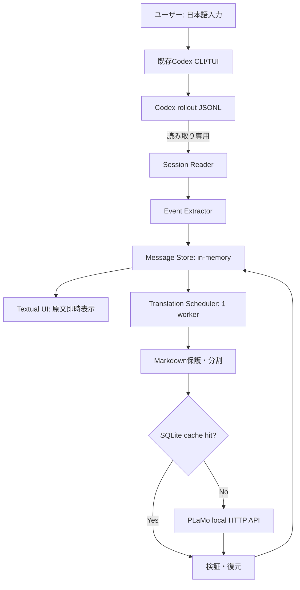

# Codex Japanese Presentation Layer — 実装設計書

- Version: 1.0
- Date: 2026-11-25
- Status: 実装指示案（実環境の互換性確認を着手条件とする）
- Implementation agent: DeepSeek
- Working name: `codex-ja`
- Deliverable: 独立したローカルCLI / TUIアプリケーション

## 0. 実装エージェントへの指示

本書に従い、動作するアプリケーション、テスト、READMEを実装する。仕様の再提案だけで終了しない。対象ディレクトリの既存ファイル・指示を先に確認し、Ricorec等の既存プロジェクトを変更しない。新規の独立ディレクトリで作業する。実行環境にない依存関係やサーバーを勝手に導入・起動しない。必要な依存をプロジェクトの依存定義に追加することは作業範囲内とする。

Phase 1から順に実装・検証し、テストの失敗を解消してから次へ進む。実環境のCodexまたはPLaMoにアクセスできない場合は、合成fixtureとmock HTTPで実装・自動検証を進め、実環境確認のみ未実施と報告する。観測結果と仕様が矛盾する場合は、根拠を記録し、該当契約を独断で広げず報告する。実データや認証情報を外部送信・コミットしない。公開・push・merge・Codex設定の変更は依頼範囲外とする。

## 1. 背景・目的

Codexへの指示は日本語で行う。Codexの人間向け進捗・計画・最終報告およびエージェント間の自然言語通信は原則英語でよい。英語の出力をローカルのPLaMo 3 Translate 2Bで日本語に翻訳し、人間が読める表示を提供する。

目的は、英語主体のモデル入出力を維持したまま、日本語で進捗や成果を確認できること。日本語出力を英語化することでトークン消費削減を期待するが、その倍率やCodex利用枠への効果は未測定であり、本アプリの合否条件にはしない。モデルの内部推論言語や日本語入力そのものを強制的に英語へ変更する機能は持たない。

### 1.1 要件

- 既存のCodex CLI/TUIは従来どおり利用し、起動・入力・承認・終了操作を変えない。
- 選択したCodexセッションの利用者向けメッセージを自動取得し、原文を先に表示し、翻訳完了後に日本語へ更新する。
- 日本語のユーザー入力を原文表示する。翻訳対象は主に英語のassistantメッセージと公開された計画とする。
- セッションの選択・切替、原文表示、翻訳失敗の確認と手動再試行、履歴の再表示を可能にする。
- 翻訳処理が失敗・停止してもCodex本体とその履歴に影響しない。
- 翻訳は既存のローカルサーバーだけで行う。外部APIへのfallbackを持たない。
- Markdownの構造およびコード、パス、コマンド、識別子を保護する。安全に分離できない部分は原文表示とする。

### 1.2 非対象

Codexの改造、PTY/ANSIの書換え、Codex app-serverによる独自チャットクライアント、入力翻訳、翻訳結果のCodexへの書戻し、サブエージェント通信・非公開推論・tool I/Oの翻訳、プロジェクトファイルの自動翻訳、翻訳サーバーの管理、課金API、Web UI、モデル自体の品質評価、複数翻訳ワーカーは対象外。

## 2. 実行環境・技術選定

| 項目 | 選定 |
|---|---|
| 対象OS | WSL2上のLinux（Windowsネイティブ対応は非対象） |
| Python | 3.12以上。初期開発環境に合わせて対応版を明示 |
| 依存管理 | uv、`uv.lock`を同梱 |
| UI | Textual、診断用の非対話CLI |
| HTTP | httpx.AsyncClient |
| JSONL / DB | 標準ライブラリ json / sqlite3 |
| Markdown | markdown-it-py（構造識別）、保護・復元は独自の小さな純粋関数 |
| 監視 | asyncioによるポーリング。初期値250ms |
| テスト | pytest、pytest-asyncio、httpx.MockTransport、Textual Pilot |
| 翻訳 | PLaMo 3 Translate 2B GGUF、既存LM Studio等のOpenAI互換サーバー |

ファイル監視専用ライブラリは採用しない。単一ファイルの増分取得ではポーリングで足りる。複数セッションのファイル全体を常時読み直さない。依存の実バージョンは実装時に互換性を確認しlockへ固定する。ライブラリのAPIを推測で実装しない。

## 3. アーキテクチャ



Codexとビューアに通信制御・プロセス親子関係はない。ビューアの正本はCodexのrolloutファイル。翻訳キャッシュとメモリ上の表示状態は破棄・再生成できる派生データとする。

### 3.1 モジュール

```text
codex-ja/
├── pyproject.toml
├── uv.lock
├── README.md
├── src/codex_ja/
│   ├── __main__.py
│   ├── cli.py           # 引数・診断CLI
│   ├── config.py        # 設定解決・URL制約
│   ├── models.py        # dataclass / enum
│   ├── session.py       # セッション発見・増分読み取り
│   ├── events.py        # JSONLの許可リスト変換
│   ├── markdown.py      # 構造識別・分割・復元検証
│   ├── cache.py         # SQLiteキャッシュ
│   ├── translation.py   # HTTP client / scheduler
│   └── ui.py            # Textual UI
└── tests/
    ├── fixtures/
    └── test_*.py
```

モジュール境界を維持する。UIが直接ファイルを読み取ったりHTTPを呼んだりしない。汎用プラグイン、repository層の抽象化、ORM、追加のサーバーを作らない。識別子・型ヒントは英語とし、関数の責務は限定する。

## 4. CLI・設定契約

`pyproject.toml`のconsole script名は`codex-ja`。

```bash
uv sync --locked
uv run codex-ja doctor
uv run codex-ja sessions
uv run codex-ja inspect --session <thread-id>
uv run codex-ja                         # TUI: セッション選択
uv run codex-ja --cwd .                 # 完全一致のcwdで候補を絞る
uv run codex-ja --session <thread-id>   # 明示選択してTUI
```

- `doctor`: 設定、セッションディレクトリの読取可否、DBの利用可否、`GET /v1/models`で接続・モデル識別子を検証。本文送信なし。成功0、失敗1、引数・設定不正2。
- `sessions`: ID、cwd、更新時刻、history modeを一覧表示。会話本文を出さない。
- `inspect`: 指定セッションの形式・イベント件数・抽出数・無視数・不正行数を出力。本文、翻訳、キャッシュ書込みは行わない。
- `--session`と`--cwd`は排他。未知IDや重複IDはエラー。複数候補なら人間が選択し、自動選択しない。`--cwd`はLinux側の絶対正規化パスで完全一致。
- 起動時、候補が一つでも翻訳対象のセッションID・cwdを表示し、ユーザーの選択確認後に本文送信を開始する。`--session`指定は選択確認として扱う。

設定ファイル: `${XDG_CONFIG_HOME:-~/.config}/codex-ja/config.toml`。TOMLの読込は`tomllib`。不明な設定項目はエラー。環境変数は下記の明示項目だけを参照し、Codexの認証設定は読み込まない。

```toml
[translation]
base_url = "http://127.0.0.1:1234/v1"
model = "plamo-3-translate-2b" # 例: /v1/models の実IDに変更
form = "polite"
```

| 設定 | 解決規則 |
|---|---|
| Codex home | `CODEX_HOME`、未指定なら `~/.codex` |
| セッションroot | `<codex_home>/sessions` |
| 翻訳URL | 設定値、未指定なら上記loopback URL |
| モデルID | 設定必須。自動で別モデルを選択しない |
| 文体 | `polite` 既定、`plain` も可 |
| キャッシュ | `${XDG_CACHE_HOME:-~/.cache}/codex-ja/translations.sqlite3` |

内部定数（初期値であり、性能計測後に変更可）: 読取間隔250ms、一覧更新2秒、接続timeout 3秒、読取timeout 60秒、1要求全体90秒、1セグメント最大1000 Unicode code points、同時HTTP要求1、初期表示50メッセージ、追加履歴50件単位、同時保留キュー上限32件。設定項目を増やさず定数を一箇所で管理する。

URLはHTTP、IPリテラルのみ。既定では`127.0.0.1`、`::1`のみ許可する。WSL2 NATでWindows側サーバーへ接続する場合は、`base_url`のホストを明示されたRFC1918プライベートIP（10/8、172.16/12、192.168/16）に設定し、そのIPがWindowsホストであることを利用者が確認する。任意のLANサービスを信頼するわけではない。URLのパスは`/v1`に限定し、userinfo、query、fragment、公開IP、ホスト名を拒否する。HTTPプロキシ環境変数を無視（`trust_env=False`）、redirectを追跡しない。接続先を自動探索しない。

## 5. Session Reader

### 5.1 セッション発見

`<codex_home>/sessions/**/rollout-*.jsonl`を対象とする。ファイル名でIDを推定せず、`session_meta`から取得する。通常の形は`YYYY/MM/DD/rollout-*.jsonl`。メタデータは`payload.id`をthread ID、`payload.session_id`が別にあってもthread IDの代替にしない。`payload.cwd`、`payload.cli_version`、`payload.history_mode`、`payload.source`、`payload.parent_thread_id`を必要に応じて使用。root外へのsymlinkは追跡しない。`archived_sessions`、圧縮ファイル、子セッション自動統合は対象外。子セッションは確認できる場合に一覧から除く。親不明は表示ラベルで区別する。

候補のソートはmtime降順、同時刻はID昇順。状態表示は「最終更新」だけとし、mtimeから実行中・終了を断定しない。メタデータがまだ書かれていない新規ファイルは次回走査で再確認する。巨大なファイル全体をメタデータ取得のために読み込まない。先頭の最初の有効メタデータのみを取得する。

### 5.2 増分読取

- 選択セッションのみ、UTF-8のバイナリ読取モード`rb`で開く。永続化済みbyte offsetとファイルのdevice/inodeをメモリに保持する。
- offsetは改行で終端された完全なレコードを処理した時だけ進める。未終端の末尾や途中のUTF-8文字は次回の追記を待つ。
- 完全な不正JSON/UTF-8行は件数・位置を診断し、内容を記録せずスキップ。最大行サイズ8MiB超は改行までストリームで読み飛ばし診断する。
- 一回のpollで最大1MiB程度ずつ読み、長い行は有界バッファで処理し、UIイベントループに制御を返す。ファイルI/Oは必要に応じて`asyncio.to_thread`へ隔離する。
- 起動/切替時はファイル先頭から解析し、表示対象だけの軽量なイベント索引（ID、offset、時刻）を作る。本文は表示分を読み戻す。過去の全本文を自動翻訳しない。終了時にoffset保存は不要。再起動時は再解析する。
- ファイル消失時は表示を保持して「ログ取得停止」を示す。サイズ縮小・inode変更・履歴の置換を検出したら対象の処理を取り消し、索引を再構築する。IDが変わった場合は自動切替しない。追記中の破損を修復しない。
- 監視対象を勝手に変更しない。切替はユーザー操作のみ。

再構築やセッション切替のたびにview generationを増やし、古い非同期結果が新画面に書き込まれないようにする。

## 6. Event Extractor

### 6.1 Codex形式の扱い（重要）

Codex upstreamの永続化ポリシーにはlegacyとpaginatedの二方式がある。新方式では`item_completed`が人間向けイベントを保持し、旧方式では`agent_message`等が保持される。`response_item`はモデル向け履歴であり、表示イベントと同一内容が含まれる場合がある。両系列を無条件に合流させない。

初期対応は以下の明示的allowlist。`session_meta.payload.history_mode`が`paginated`ならP、`legacy`または省略ならLを使用する。ただし実環境で省略形式と異なる場合は互換性確認の結果で修正する。未知のmodeは本文送信を停止して「未対応形式」と表示。実際のCodex版で確認するまで全バージョン互換を宣言しない。

| Mode | 外側`type` | `payload.type` | 採用内容 |
|---|---|---|---|
| L | event_msg | user_message | `payload.message`（原文） |
| L | event_msg | agent_message | `payload.message`、`payload.phase` |
| L/P | event_msg | item_completed | `item.type == "Plan"` の `item.text`（存在と型を確認） |
| P | event_msg | item_completed | `item.type == "UserMessage"` の `content`中`type == "text"`の`text` |
| P | event_msg | item_completed | `item.type == "AgentMessage"` の `content`中`type == "Text"`の`text`、`item.phase` |

`phase == "commentary"`は進捗、`phase == "final_answer"`は最終回答、それ以外・未指定は「応答」と表示する。空本文はスキップ。配列中の文字列本文は出現順に連結（改行を勝手に補わない）。公開されたPlanの構造が実環境で異なる場合はPlanアダプタを確認し、確認できなければPlanのみ対象外と明示。`response_item`、reasoning、raw reasoning、tool、system、developer、compacted、subagent内部通信、delta、turn完了に含まれる最終回答の複製はすべて対象外。

`response_item`しか存在しないログは非対応。対象イベント0件なら空表示を成功扱いせず、形式確認を案内する（メタデータしかない新規ファイルは待機表示）。未知イベントの内容を推測して翻訳しない。

### 6.2 合成fixture例（実ログのコピーではない）

Legacy:

```jsonl
{"timestamp":"2026-11-25T01:00:00Z","type":"session_meta","payload":{"id":"legacy-thread","cwd":"/tmp/demo","history_mode":"legacy"}}
{"timestamp":"2026-11-25T01:00:01Z","type":"event_msg","payload":{"type":"user_message","message":"保存処理を調べて"}}
{"timestamp":"2026-11-25T01:00:02Z","type":"event_msg","payload":{"type":"agent_message","message":"I will inspect the storage layer.","phase":"commentary"}}
{"timestamp":"2026-11-25T01:00:02Z","type":"response_item","payload":{"type":"message","role":"assistant","content":[{"type":"output_text","text":"I will inspect the storage layer."}]}}
```

Paginated:

```jsonl
{"timestamp":"2026-11-25T01:00:00Z","type":"session_meta","payload":{"id":"new-thread","cwd":"/tmp/demo","history_mode":"paginated"}}
{"timestamp":"2026-11-25T01:00:01Z","type":"event_msg","payload":{"type":"item_completed","turn_id":"turn-1","item":{"type":"UserMessage","id":"u1","content":[{"type":"text","text":"保存処理を調べて"}]}}}
{"timestamp":"2026-11-25T01:00:02Z","type":"event_msg","payload":{"type":"item_completed","turn_id":"turn-1","item":{"type":"AgentMessage","id":"a1","phase":"commentary","content":[{"type":"Text","text":"I will inspect the storage layer."}]}}}
{"timestamp":"2026-11-25T01:00:03Z","type":"event_msg","payload":{"type":"item_completed","turn_id":"turn-1","item":{"type":"AgentMessage","id":"a2","phase":"final_answer","content":[{"type":"Text","text":"The tests passed."}]}}}
```

### 6.3 内部データ契約

```python
@dataclass(frozen=True)
class Message:
    thread_id: str
    message_id: str
    revision: str       # sha256(original UTF-8)
    sequence: int       # file byte offset; order within thread
    timestamp: str      # original RFC3339, invalid -> unknown UI label
    kind: MessageKind   # USER, COMMENTARY, FINAL, PLAN, ASSISTANT
    original: str
```

PのIDは`item.id`を使用（必須）。Lはthread IDとbyte offsetから生成する。Planは同様にitem.idがあれば使用し、ない場合はoffsetを使用。識別キーは`(thread_id, message_id)`。同一キー・同一revisionの再受信は何もしない。同一キー・異なるrevisionは元の表示位置を保持した上で更新し、古い翻訳を無効にする。別IDで同じ本文が繰り返された場合は別メッセージとして表示（翻訳キャッシュだけ共有）。テキストハッシュのみで会話イベントを重複排除しない。

セッション内順序はファイル順で保持し、翻訳完了順で並べ替えない。履歴のrollback/compactionによる再構成はv1対象外であり、表示は観測されたイベントの時系列とする。Codexの現在の有効contextを再現するビューアではない。

## 7. Markdown保護と翻訳単位

### 7.1 基本方針

翻訳済み文字列を原文として扱わない。原文は不変のまま保持し、翻訳結果は表示専用とする。Markdownを一括して翻訳モデルへ送る処理は禁止。構造を確実に保護できる範囲から実装する。

1. Markdownを解析し、行位置を利用して元文字列の範囲を特定する。ASTを再シリアライズして原文を作り直さない。
2. コードフェンス、インデントコード、HTMLブロック、数式、画像、表、複雑な入れ子リスト、構造化データ、独立したコマンド行はブロックごと原文のまま保持する。GFM表を認識できるようテーブル解析を有効にする。曖昧なブロックは原文保持する。
3. 通常の段落・見出し・単純なリスト項目を翻訳対象とする。見出し記号、リストマーカー、改行、空白、引用マーカーは原文側で保持する。リスト内の複雑なMarkdownは対象外。
4. インラインコード、Markdownリンク（ラベルを含む）、URL、パス、認識可能なコード識別子、CLIオプション、既知の機械判定用フィールドを保護する。裸のコマンドや自然言語と区別できない識別子の完全自動保護は保証できないため、原文表示を常に提供する。
5. 保護部分はモデルへ渡さず、衝突しないASCIIの一時マーカーに置き換える。各マーカーは入力と出力で一度ずつ同順に出現することを検証し、検証成功後だけ元の文字列を完全一致で復元する。欠落・重複・順序変更・未知マーカーがあれば、そのセグメントを原文表示に戻す。マーカー以外の原文の機密判定は別途行う（§11）。
6. 翻訳対象が日本語文字のみ、数値・記号のみ、英字を含まない場合は送信しない。日本語を含む混在文は保守的に原文表示する（初期仕様）。英字を含む文章でも既知のコードブロックは送信しない。
7. 英文が長い場合は段落内の文境界・空白境界で1000 Unicode code points以下へ分ける。保護マーカーを分断しない。区切れない長文は原文保持。前後の空白と改行を失わない。

翻訳単位は各セグメント。長い回答はセグメント順に処理して完成分だけ表示に反映してよい。異常な出力（空文字、切り詰め、保護マーカー不整合、制御文字、予期しないMarkdown構造の追加）はキャッシュしない。原文の保護範囲とMarkdown構造を復元後に検査する。安全なMarkdown表示に必要なエスケープは表示時に行い、原文は変更しない。

### 7.2 サンプル

入力:

~~~markdown
## Results

I updated `store.py` and ran the targeted tests.

- All tests passed.
- Review `tests/test_store.py` before merging.

```bash
uv run pytest tests/test_store.py
```
~~~

表示例（訳文は例示であり完全一致の期待値ではない）:

~~~markdown
## 結果

`store.py`を更新し、対象テストを実行しました。

- すべてのテストが成功しました。
- マージ前に`tests/test_store.py`を確認してください。

```bash
uv run pytest tests/test_store.py
```
~~~

保護用マーカーの復元が失敗した場合、その段落のみ英語で保持し「部分翻訳」を示す。モデルが指示に従うことを構造保護の根拠にしない。

## 8. PLaMo Client

### 8.1 HTTP契約

PFN公式GGUFモデルカードのOpenAI互換API経路を使用する。`model`は実際のロード済みモデルIDを設定する。固定の推定IDを使ってモデルを切り替えない。

```http
POST /v1/chat/completions
Content-Type: application/json
```

```json
{
  "model": "plamo-3-translate-2b",
  "messages": [
    {"role": "system", "content": "[plamo-translate]\nsource_lang=en\ntarget_lang=ja\nform=polite"},
    {"role": "user", "content": "The storage layer requires atomic writes."}
  ],
  "stream": false
}
```

ここで示すsystem message形式は公式モデルカードに基づく。実サーバーのモデルテンプレートが対応することはPhase 1で確認する。Codexの会話履歴、tool結果、設定、システムプロンプトを追加の翻訳contextとして送らない。翻訳用の1セグメントだけを送信する。

- HTTP 2xxかつ`choices[0].message.content`が空でない文字列であることを検証する。
- `finish_reason`が`length`等の未完了を示す場合は失敗。既知の正常終了理由`stop`のみをv1で受け入れる。サーバーが異なる形式を返す場合は互換性を確認してから契約変更する。
- 非2xx、timeout、接続失敗、不正JSON、空応答、構造不正は型付きエラーへ変換する。
- リクエストの自動再試行は行わない。失敗は原文表示とエラー分類を保持し、利用者が`r`を押した場合に対象メッセージの失敗部分のみ再試行する。
- 接続・timeout・5xx等でサーバーが利用不能になった場合、未送信要求を保留し、ステータスを表示。`r`で接続再確認後に再開する。4xxや出力構造異常は対象を失敗とし、必要なら設定修正を案内する。無制限に送信しない。
- ローカルHTTPでも応答を信頼済みデータと扱わない。実行・評価判定・承認操作には一切使わない。

## 9. Translation Scheduler / Cache

### 9.1 状態モデル

| 状態 | 意味 |
|---|---|
| ORIGINAL | 原文受信済み、未予約 |
| SKIPPED | ユーザー入力、保護ブロック、翻訳不要・対象外 |
| QUEUED | 翻訳待ち |
| TRANSLATING | 翻訳中 |
| TRANSLATED | 全翻訳対象セグメント成功 |
| PARTIAL | 一部翻訳成功、一部原文保持・失敗 |
| FAILED | 翻訳対象がすべて失敗、原文維持 |

`SKIPPED`は正常な非対象とし、通信エラーと混同しない。保護済みコードを原文で残すことだけで`PARTIAL`とはしない。`PARTIAL`は本来翻訳すべきセグメントのうち復元失敗や長文等の保守的除外があった場合。すべてのセグメントが意図的非対象の場合は`SKIPPED`。状態・結果は翻訳単位の結果から導出する。モデル自己申告を状態決定に使わない。

### 9.2 スケジューリング

- 1プロセスにつきHTTPワーカー1個。`asyncio`でUI・読取処理から独立させる。
- 選択セッションの初期表示50件は原文を先に表示し、未キャッシュの翻訳を新しい順に予約する。以降の新着は最優先し、同優先度では受信順。過去履歴を追加表示した場合は表示された対象だけを低優先度で予約。
- 同時保留キューは最大32件。入りきらない対象はORIGINALのまま保持し、空きができ次第予約する。脱落させない。長いメッセージは1セグメントずつ実行し、その間に新着を優先可能とする。
- 同一セグメントのcache keyに対する同時要求は統合する。同一メッセージrevisionへの二重予約は禁止。
- セッション切替時は旧セッションの未送信ジョブを取り消す。実行中のHTTPは取消を試み、完了結果はキャッシュに保存してもよいが、新画面に適用しない。切替中も同時HTTP要求数は1以下。
- UI更新前に`thread_id`、`message_id`、`revision`、`view_generation`を照合する。古いrevisionやgenerationの結果を破棄する。
- 終了時は新規要求を止め、進行中タスクをcancelし、HTTP/DBを閉じる。Codexへのsignal送信は行わない。

### 9.3 SQLite

DBは翻訳成功結果のキャッシュのみ。元のtranscriptを丸ごと複製しない。元のファイルのoffsetやUIの位置を永続化する必要はない。

```sql
CREATE TABLE IF NOT EXISTS translations (
    cache_key TEXT PRIMARY KEY,
    translated TEXT NOT NULL,
    created_at TEXT NOT NULL
);
```

cache keyは以下の値のJSON配列をUTF-8でシリアライズしたもののSHA-256（区切りの曖昧性をなくす）。

```text
[cache_schema_version, translation_policy_version,
 base_url, model_id, source_lang, target_lang, form,
 protected_source_segment]
```

`protected_source_segment`は保護マーカーを置いた送信文字列。キャッシュには検証済みで保護マーカーを残した翻訳結果を保存し、読込時にもマーカー検査して現在の元の保護部分を復元する。実際のパスやコードを含む復元後の本文をDBに保存しない。入力文字列そのものはDBに保存しない。モデルが同じIDのまま差し替えられた場合は自動検知しない。READMEにキャッシュファイルの手動退避・再生成手順を記載する。

DB接続は専用の短時間処理に限定し、トランザクションで保存する。破損・ロック・書込不可時は診断とともにキャッシュを無効化し、メモリ上の翻訳結果を利用できる状態で継続する。自動削除・再作成で既存DBを破壊しない。キャッシュ不能時の再起動後は再翻訳が必要であることを表示する。スキーマ変更を伴う将来版は新しいcache schema versionを使用する。

## 10. Textual UI

### 10.1 画面構成

```text
┌─ codex-ja ── anki-deck / thread: 1234… ──────┐
│ PLaMo: 接続中 | 待ち: 2 | 最終更新: 10:21:18 │
├─────────────────────────────────────────────┤
│ 10:21:00  あなた                             │
│ 保存処理を調べて                             │
│                                             │
│ 10:21:03  進捗報告                         │
│ 保存処理を調査します。                       │
│                                             │
│ 10:21:18  最終回答 [翻訳中]                 │
│ The targeted tests passed.                  │
│                                             │
├─────────────────────────────────────────────┤
│ s: セッション o: 原文/翻訳 r: 再試行       │
│ h: 履歴追加 End: 最新 q: 終了               │
└─────────────────────────────────────────────┘
```

- 本文はMarkdownとして読みやすく表示する。原文モードでは翻訳を混ぜない。翻訳モードでは未翻訳部分を原文で表示し状態を示す。原文は必ず確認可能。
- `s`: セッション選択モーダル。ID、cwd、最終更新、履歴形式を表示。選択後だけ監視・翻訳を切り替える。
- `o`: 全体の原文/翻訳表示を切替。原文モードでも翻訳処理は続けてよい。
- `r`: 失敗対象の再試行・接続再確認。失敗対象がなければ何もしない。
- `h`: 直前の履歴50件を追加表示。表示した履歴だけを翻訳候補にする。
- `End`: 最新へ移動、オートスクロールを再開。ユーザーが過去を読んでいる間は新着でスクロール位置を移動させない。
- `q`: ビューアだけ終了。

TUIにはCodexへの入力欄、承認ボタン、コマンド実行、クリックによる外部リンク起動を実装しない。翻訳された承認案やコマンドを実行可能な操作として表示しない。端末幅の変更と日本語の折り返しに対応する。未処理メッセージ数を表示する。

### 10.2 実行例

WSLで2つのターミナルまたはWindows Terminalの分割ペインを開く。

```bash
# 左ペイン: 既存プロジェクト
cd /path/to/project
codex
```

```bash
# 右ペイン: 独立ツール
cd /path/to/codex-ja
uv run codex-ja --cwd /path/to/project
```

新しいセッションを開始するときは右ペインのセッション一覧から選択。起動時に該当セッションがなくても一覧の再検出を待てる。Codex側の操作と独立しているため、ビューアを終了・再起動してもCodexの実行は継続する。

## 11. 安全性・データ管理

- `CODEX_HOME`配下の既存セッションファイルは読取り専用。ファイル作成・書換え・削除・移動・chmodをしない。`auth.json`、設定ファイル、APIキー等を探索しない。
- 許可されたイベントの自然言語本文だけを翻訳サーバーへ送る。ユーザー入力、tool、reasoning、system/developer、子エージェント通信は送信対象外。
- 明示的な秘密情報（PEM秘密鍵、Bearer token、代表的なAPIキー形式、認証情報を含むURL等）を含むセグメントは翻訳をせず、UI上は原文表示を維持する。検出の完全性は保証できない。ローカルサーバー側での要求ログ保持も利用者が確認する必要がある。
- ビューアの診断ログに原文・訳文・HTTP body・トークン・認証情報を出さない。許可されたエラー分類、件数、offset、状態、経過時間のみ。生の例外本文をそのまま表示しない。
- キャッシュはユーザー専用ディレクトリ（Linuxで0700、DB 0600）に置く。既存キャッシュの権限が広い場合は自動変更せず診断し、利用停止する。Gitの追跡対象に含めない。
- HTTPは§4の明示的なローカル宛先だけ。クラウド接続、テレメトリ、自動アップデート、他サービスへの転送は実装しない。RFC1918宛先はネットワーク上を平文で通る場合があるため、信頼できる自端末のみに限定する。
- 端末のANSI/OSC制御コード、制御文字等は表示時に無害化する。原文保存は変更しない。MarkdownのHTMLやリンクからネットワークアクセス・コード実行を誘発しない。
- 翻訳は参考表示。承認や破壊操作を判断する際には既存Codexの原文を参照する。UI上で翻訳の成功をCodexの実行成功と混同しない。

## 12. 実装順序と検証

### Phase 1 — 互換性と最小の疎通

1. `codex --version`およびローカルの実セッションの存在を確認する。利用可能な場合のみ、対象イベントの形式・件数・history mode・ID・書き込み頻度を読取り専用で確認する。実本文のコピーは作成しない。
2. `GET /v1/models`でモデルIDを確認し、機密情報を含まない固定英文1件を送る。HTTP形式、翻訳結果、応答時間を確認。モデル能力のベンチマークは行わない。
3. config、CLI診断、Session Reader、Event Extractor、mock可能なHTTP clientを実装する。合成fixtureでL/P双方をテストする。

Exit criteria: 取得・翻訳・表示がCLIで成立すること。実環境にアクセスできない場合はmockの合格と実環境未確認を分けて報告する。未知形式を推測で読まない。

### Phase 2 — TUIとリアルタイム更新

Message Store、Scheduler、Textual UIを実装。原文先行表示・翻訳更新・複数セッションからの選択・スクロール・終了を検証する。

Exit criteria: 合成JSONLを追記すると、TUIが原文を追加し、非同期翻訳結果で同じメッセージを更新する。翻訳失敗・切替・終了でCodexに作用しない。

### Phase 3 — Markdown保護と再開対応

構造保護、復元検証、SQLite cache、バックプレッシャー、履歴追加、異常系を実装する。再起動後にキャッシュを再利用する。Phase 2までの実験中は合成英文のみで翻訳し、実際のtranscriptの自動翻訳は本Phase完了後に確認する。

Exit criteria: §13の自動テストが合格し、実運用向けのREADMEと制約一覧が揃う。

Phase 4の独自app-server、サブエージェント横断表示、Web UIなどは実装しない。v1は単一選択セッションを監視するが、セッション一覧から切替可能とする。

## 13. テスト・受入条件

実装内部の関数呼出回数等より、外部から観測可能な契約を優先する。テストに実際のCodexログ、PLaMoサーバー、GPU、ネットワークを必須としない。

| ID | 条件 / 操作 | 期待結果 |
|---|---|---|
| A01 | L/Pそれぞれの合成ログ | 正しいユーザー・assistant・Plan（対応形のみ）を抽出し、順序を維持 |
| A02 | `response_item`やtool等を混在 | 重複なし、対象外本文のHTTP送信0 |
| A03 | 未知history mode / schema | 未対応と表示、本文送信0 |
| A04 | 行・UTF-8の途中で追記停止 | 完成まで無視、完成後1回だけ追加 |
| A05 | 完全な不正行・巨大行・未知イベント | boundedに処理し診断、後続の有効行を取得 |
| A06 | 同一item IDとrevisionの再受信 | 表示・翻訳の二重予約なし |
| A07 | 同一item IDの本文更新 | 同位置で原文更新、旧翻訳は適用しない |
| A08 | 異なるitem IDで同じ本文 | 2メッセージ表示、キャッシュは再利用 |
| A09 | 50件超の初期履歴 | 最新50件だけを表示・予約、追加履歴は操作時のみ |
| A10 | 翻訳が遅いmock | 原文を先に表示、UIが応答可能、同時HTTP最大1 |
| A11 | 32件超の翻訳待ち | キュー上限を維持し、待機分を失わない |
| A12 | timeout、非2xx、不正JSON、空、未完了 | 状態を明示し原文保持、勝手に再試行しない |
| A13 | サーバー復旧後の手動再試行 | 失敗部分だけ成功に更新、既成功部分を再送しない |
| A14 | コード・パス・リンク・Markdown | 保護対象は送信せず、表示時に元文字列が一致 |
| A15 | マーカー消失・重複・並べ替え | 原文保持、失敗をキャッシュしない |
| A16 | 日本語入力・日本語混在文・構造化データ | 初期ルールどおり送信しない |
| A17 | セッション切替中に旧翻訳が完了 | 新画面に混入しない |
| A18 | ファイル置換・縮小・消失 | 状態表示、再構築/停止、別IDへ自動切替しない |
| A19 | 再起動・同一cache key | 成功結果再利用、HTTP呼出0 |
| A20 | cache keyのモデル・文体・policy変更 | 古いキャッシュの誤使用なし |
| A21 | DBロック・破損・権限不正 | 診断、非破壊、メモリ処理を継続 |
| A22 | 公開IP、URLのuserinfo、redirect、proxy環境 | 外部送信されない |
| A23 | 秘密情報、ANSI/OSC、危険なMarkdown | 既知の秘密情報は送信せず、制御文字等は無害表示 |
| A24 | 起動から終了まで対象ログを比較 | transcriptの内容とmtime不変、Codex起動・停止・操作の呼出なし |
| A25 | ユーザーが上へスクロール中に追記 | 読書位置保持、Endで最新に移動 |
| A26 | doctor / inspect / sessions | 本文を送信せず、stdoutに本文・秘密を出さない |

### 13.1 手動確認（実環境でのみ）

- WSL側から既存LM Studioへ接続し、`doctor`成功を確認。
- Codexで日本語の短い指示を行い、英語の進捗報告と最終回答が出る実セッションを選択する。
- ビューアで原文→翻訳への更新、原文切替、別セッション選択、再起動時のキャッシュ利用を確認する。
- 翻訳サーバーを停止できる環境の場合は利用者が停止し、ビューアのエラー状態とCodexの独立動作を確認。勝手に利用者のサーバーを停止しない。
- 通常の短文と長文について、ログの完全行が読取可能になった時点から原文表示・翻訳表示までの時間を記録する。モデル生成からディスク永続化までの遅延は別の指標とする。
- 初期性能目標: 選択済みセッションの通常サイズ新着について、完全行の読取可能時点から原文表示まで500ms以内（平常時）。翻訳時間は実サーバー依存であり、測定値を報告する。固定の翻訳秒数は合否にしない。

## 14. Definition of Done

- `uv sync --locked`で依存を再現でき、`uv run codex-ja --help`が成功。
- `uv run pytest -q`で§13の対象契約が合格。Ruff lint・format checkを導入し、合格する。
- READMEにインストール、設定例、実モデルIDの確認、WSL接続、Codex英語出力方針、診断、操作、キャッシュ退避、非対応範囲を記載。
- 自動テストと手動実機確認を分けて報告し、未確認を成功扱いしない。
- リポジトリに実transcript、認証情報、個人環境固定パス、キャッシュが含まれない。
- 全変更の差分が本書の範囲内である。過剰な抽象化、要求外の設定項目、クラウドfallbackを追加しない。

### 14.1 Codex側の言語ポリシー（README掲載のみ）

利用者が希望する場合、Codexのグローバル指示へ以下を手動で設定する。アプリが自動編集しない。

```markdown
## Language Policy

- Accept user instructions in Japanese.
- Use English for plans, progress updates, conversational responses,
  final reports, and communication between agents.
- Do not provide a Japanese translation of conversational responses;
  an external presentation layer handles translation.
- Preserve the language required by project instructions and artifacts.
```

日本語入力はcontextに残り、既存の日本語仕様書等も変更しない。内部推論の言語を保証する設定ではない。リポジトリ固有の言語指定と衝突する場合は適用ルールを確認する。

### 14.2 DeepSeekの最終報告形式

```markdown
## 実装結果
- STATUS: COMPLETE / PARTIAL / BLOCKED
- 実装済みPhase:
- 実際の変更ファイル:
- 実行方法:

## 検証結果
- 自動テスト: 実コマンド・終了コード・件数
- Lint / Format: 実コマンド・終了コード
- Codex実機: 版、history mode、確認結果または未実施理由
- PLaMo実機: モデルID、確認結果または未実施理由
- 表示遅延: 測定条件と実測値、または未測定

## 残存事項
- 仕様と実装の差分:
- 未確認事項・制約:
- 利用者による設定・確認が必要な事項:
```

`COMPLETE`は自動テストと対象実環境確認が揃った場合に限る。実環境を利用できない場合は、コードが完成していても`PARTIAL`とし、未確認範囲を明記する。

## 15. 設計判断と未確定事項

| 判断 | 根拠 / トレードオフ |
|---|---|
| 独立したTUI | Codex本体を変更せず、更新への追従範囲を小さくする |
| JSONL監視 | 既存の対話UIを維持。内部保存形式・flush時期への依存を受け入れる |
| event_msg優先、response_item非採用 | モデル履歴との重複・対象外データ送信を避ける |
| ポーリング | WSLでの単純な増分読取に十分と判断。性能は未実測 |
| 選択セッションだけ翻訳 | GPU負荷と意図しない情報送信を抑制 |
| 1ワーカー、部分更新 | 翻訳遅延からCodexとUIを隔離し、負荷を限定 |
| 原文保持を優先 | 翻訳の誤りがコードや操作の判断に混入するのを抑える |
| SQLiteキャッシュ | 再起動・再表示時の推論を省く。訳文のローカル永続化は発生する |
| 複雑なMarkdownは原文 | v1の構文保護を単純にし、構造破損を防ぐ |

この設計書で指定したPython対応版、ポーリング間隔、履歴件数、キュー上限、timeout、分割長、UIキー、Markdownの保守的な対象範囲は実装の初期値として設定したもので、ユーザーの明示要求値ではない。実測結果に根拠のある変更だけを行う。

未確認: 利用者のインストール済みCodexの版・実ログ形式・flushタイミング、PLaMoサーバーの実モデルID・設定・応答速度、WSLのネットワーク構成。公開ソースから確認できた形式を設計に反映したが、ローカル環境での動作は未検証。Codex更新でログ形式が変更される可能性がある。token streamの完全リアルタイム追従は保証しない。

## 16. 参照資料

2026-11-25時点の公開資料。GitHubの`main`は可変であり、実装時に確認したCodexの版・参照コミットをREADMEまたは報告に残す。

- OpenAI Codex rollout永続化ポリシー（legacy / paginatedの区別）: https://github.com/openai/codex/blob/main/codex-rs/rollout/src/policy.rs
- OpenAI Codex rollout recorder: https://github.com/openai/codex/blob/main/codex-rs/rollout/src/recorder.rs
- OpenAI Codex rollout recorder tests: https://github.com/openai/codex/blob/main/codex-rs/rollout/src/recorder_tests.rs
- OpenAI Codex TurnItemデータ定義: https://github.com/openai/codex/blob/main/codex-rs/protocol/src/items.rs
- OpenAI Codex rollout fixture生成: https://github.com/openai/codex/blob/main/codex-rs/app-server/tests/common/rollout.rs
- PFN PLaMo 3 Translate 2B GGUF日本語README: https://huggingface.co/pfnet/plamo-3-translate-2b-GGUF/blob/main/README_ja.md

以上の公開資料は実装上の契約確認に使用する。テスト例・アプリ内部のデータ形式・UI・制限値は本設計書で定義した新規仕様である。
