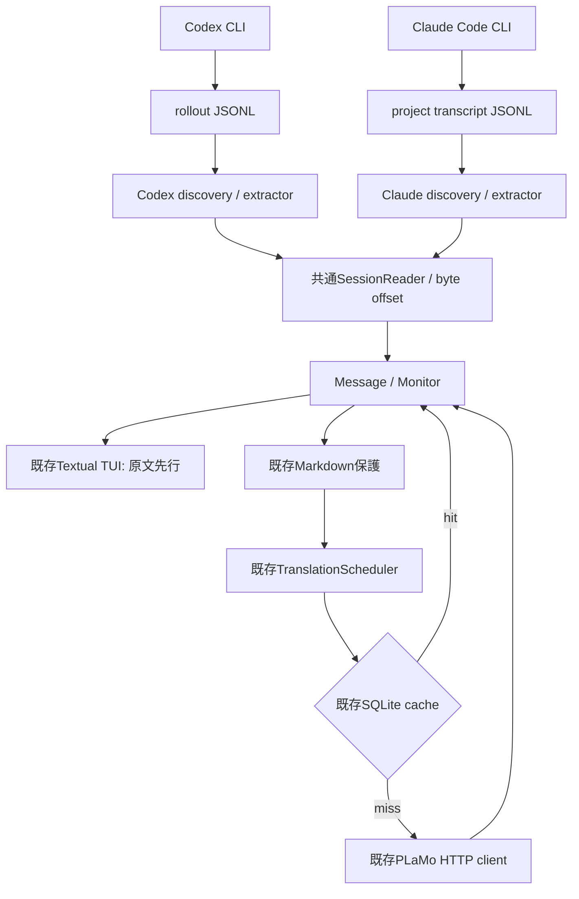

# Transpane — Claude Code対応 実装設計書

- 版: 1.0
- 作成日: 2026-11-25
- 状態: 実装指示案（Claude Code実環境の形式確認を含む）
- 対象: [yuggr/transpane](https://github.com/yuggr/transpane)
- 調査基点: [`1c6a61d`](https://github.com/yuggr/transpane/commit/1c6a61de52e4b366d1d61afe46e49ec5d6d91ac6) (`main`)
- 実装担当: DeepSeek等の開発エージェント
- 上位仕様: `docs/superpowers/plans/transpane-design-v1.0.md`

## 0. 実装担当への指示

本書は既存TranspaneにClaude Code対応を追加する差分仕様である。本書で変更する契約以外は上位仕様と現行の公開契約を維持する。現行HEAD、作業ツリー、適用されるAGENTS.md等、関連テストを確認してから着手する。基点より後の変更があれば実装対象と照合し、他者の変更を戻さない。

実装・自動テスト・README更新・結果報告まで行う。依存ライブラリ、翻訳方式、UIフレームワークを入れ替えない。実Claude Codeが利用できない場合は合成fixtureとmockで実装・検証を進め、実機互換性を未確認として報告する。実ログの形式が本書の仮定に合わない場合、対象の型・キー・版・件数を報告し、無条件のテキスト抽出を追加しない。

既存のClaude CodeやCodexの設定変更、エージェント起動・停止、課金実行、実ログのコピー・外部送信、push・公開・mergeは本書だけでは承認しない。実機確認は利用者が既に用意した環境・許可したセッションの範囲で行う。

## 1. 目的とスコープ

Claude Codeの標準CLIを日本語で操作し、英語の応答をTranspaneでローカル翻訳して閲覧できるようにする。既存Codex対応を残し、同じアプリ・設定・キャッシュ・TUIからいずれのセッションも選択できるようにする。

### 1.1 要件

- Claude Codeの保存済みおよび進行中のメインセッションを発見・選択・監視する。
- ユーザー入力を原文表示し、assistantの公開テキストを既存の翻訳パイプラインに渡す。
- 原文先行表示、自動翻訳、原文切替、履歴追加、失敗時の再試行、既存の接続状態表示を維持する。
- CodexとClaude Codeの両方を同一のセッション選択画面で識別できる。
- 同時監視は引き続き1セッション、翻訳HTTPワーカーは1つとする。
- Claude Codeへの入力・実行・承認経路に介入せず、翻訳結果を書き戻さない。
- 上位仕様のローカル通信制約、秘密情報保護、Markdown保護、キャッシュ検証を維持する。

### 1.2 非対象

Claude Code本体の改造、PTY出力の書換え、hooksの自動登録、Agent SDKの導入、`claude -p`のラッパー、Claude API呼出、非公開thinking、ツール入出力、subagentログ、agent teamsの内部通信、添付ファイル、画像、スラッシュコマンド内部処理、planファイルの追跡、入力翻訳、クラウドセッション、Windowsネイティブ対応は対象外。複数のセッションを同時翻訳する機能も追加しない。

表示は観測された会話イベントのファイル順とする。Claude Codeの現在の有効context、rewind後の有効な分岐、fork元の履歴、compaction後のcontextを再現する機能は持たない。実際の承認や危険なコマンド実行は標準CLIの原文で判断する。

## 2. 調査結果と実装上の根拠

### 2.1 確認済みの事実

| 項目 | 根拠 |
|---|---|
| Claude Codeの標準transcript | `~/.claude/projects/<project>/<session-id>.jsonl`。公式Manage sessionsに記載。 |
| 設定ルート | `CLAUDE_CONFIG_DIR`で変更可能。公式Settings filesに記載。 |
| transcript形式の安定性 | 公式は内部形式でありリリースで変更され得ると明記。直接解析は互換性保証の対象外。 |
| 現行Transpane | `src/transpane/`に改名済み。`session.py`はCodex専用のファイル発見・session_meta・増分読み取り、`events.py`はCodex legacy/paginatedの抽出を担当。 |
| 既存状態管理 | `Monitor`は選択中の単一SessionReader、`MessageView`、generation、翻訳Schedulerを保持。 |
| キャッシュ | providerに依存せず、翻訳ポリシー・URL・モデル・言語・文体・保護済みセグメントでキーを構成。 |

参考資料の実測記録では、Claude Codeは1つのモデル応答を複数JSONL行へ分割することがあり、複数行が同じ `message.id` を持つ。`user`レコードにはユーザー入力のほかtool_resultや内部注入が含まれる。これらは公開形式の保証ではない。採用するフィールドと除外条件は§5を実装契約とし、Phase 0で実機確認する。

### 2.2 取得方式の選定

| 方式 | 評価 |
|---|---|
| 既存JSONLの読み取り | 採用。既存Codex方式と同様に独立動作でき、過去履歴も読める。 |
| Claude Code hooks（MessageDisplay等） | 公式に表示イベントを扱う仕組みがあるが、設定・実行経路を変更するため今回は採用しない。 |
| Agent SDK / stream-json | 独自起動・クライアントの構築が必要になるため対象外。 |

JSONLの取得遅延によりClaude Code画面と完全に同期しないことがある。ストリーミング中の各文字を翻訳する要求は設けない。将来、実測でログ形式の追従コストや永続化遅延が問題になった場合だけ別設計を検討する。

## 3. アーキテクチャ



図は論理的な処理の流れ。実際はSessionReaderが完全行を抽出器へ渡してMessageを得る。provider固有の処理は発見・メタデータ解釈・イベント抽出に限定する。HTTP、Markdown、キャッシュ、TUI描画は共通のままとする。

### 3.1 変更対象と責務

| ファイル | 変更内容 |
|---|---|
| `src/transpane/models.py` | `AgentProvider` enum、`SessionInfo.provider`、Claude用形式ラベル。 |
| `src/transpane/config.py` | `claude_home`、`claude_projects_root`を解決。既存Codex設定は維持。 |
| `src/transpane/events.py` | 既存Codex Extractorを維持。`ClaudeExtractor`を追加して同じ`ExtractResult`を返す。 |
| `src/transpane/session.py` | Claudeセッション発見、providerに応じた抽出・メタ情報検証、両者を統合する発見入口。既存の増分読取を再利用。 |
| `src/transpane/cli.py` | providerフィルタ、診断、選択の統合。 |
| `src/transpane/ui.py` | 統合リスト、providerラベル、選択したファイルに対応したReader、切替時の世代管理。 |
| `src/transpane/translation.py` | 必要な範囲で旧generationのジョブ取消を修正。翻訳API・キャッシュ契約・接続状態判定は維持。 |
| `README.md` / テスト | 使用方法、制約、合成fixture、既存テストの必要な拡張。 |

新しい汎用providerフレームワーク、plugin discovery、registry、factoryクラス群は作らない。現時点で2種類しかないため、明示的なenumと少数の分岐・関数で足りる。実装に際して関数が過大になった場合のみ、Claude固有処理を`claude.py`へ分離してよい。`markdown.py`・`cache.py`は原則変更しない。

## 4. 設定、セッション発見、CLI

### 4.1 設定

| 項目 | 解決規則 |
|---|---|
| Codex home | 既存の `CODEX_HOME` または `~/.codex` |
| Codex root | `<codex_home>/sessions` |
| Claude home | `CLAUDE_CONFIG_DIR`（非空）または `~/.claude`、expanduser |
| Claude root | `<claude_home>/projects` |
| 翻訳設定 | 既存 `$XDG_CONFIG_HOME/transpane/config.toml` |
| 翻訳キャッシュ | 既存 `$XDG_CACHE_HOME/transpane/translations.sqlite3` |

設定ファイルにprovider別の翻訳モデル・URL・文体は追加しない。既存TOMLを変更せず動作する。Claude Codeの設定ファイルや資格情報を読み取らない。既存のURL検証を緩和しない。WSLからWindowsのClaude Code履歴へ暗黙に探索範囲を拡張しない。

### 4.2 providerとセッションの識別

```python
class AgentProvider(StrEnum):
    CODEX = "codex"
    CLAUDE = "claude"
```

`SessionInfo.provider`を追加し、既存CodexはCODEXとする。現行の`SessionInfo.source`はCodexの起動元等のメタデータなので、provider判定へ転用しない。

- `SessionInfo.thread_id`: Codexのthread ID、Claude Codeのsession IDを元の文字列で保持。
- `SessionInfo.path`: 検証済みの実ファイルパス。
- `SessionInfo.cwd`: transcriptのcwd。Claude Codeは最初の適格メタ情報で取得した開始cwdとし、`--cwd`はこの値の完全一致とする。
- `SessionInfo.cli_version`: Claude Codeの`version`、Codexは既存値。
- `SessionInfo.history_mode`: Claude Codeは内部ラベル `claude-jsonl`。Codexの`legacy`/`paginated`判定に混ぜない。
- `SessionInfo.parent_thread_id`: Claude CodeはNone。子セッションを推測しない。

セッション候補の選択単位は `(provider, thread_id, path)`。表示上の識別子は`codex:<id>` / `claude:<id>`とする。既存のraw ID指定は一意に解決できる場合だけ許容する。同じprovider内で同一IDの複数ファイルがある場合、従来どおりCLI指定はエラー、TUIでは行単位で選ぶ。

### 4.3 Claude Codeの候補発見

候補を `<claude_projects_root>/<project>/<session-uuid>.jsonl` の直下ファイルに限定する。再帰的に全ファイルを検索しない。project名からcwdを逆変換しない（元パスのハイフンと区別できない）。

1. rootを解決してディレクトリの存在・読取可否を確認する。rootを明示環境変数で指定している場合も、その解決済みrootを境界とする。
2. root直下の通常ディレクトリを列挙し、各project直下のUUID形式の通常`.jsonl`ファイルを候補とする。UUIDの標準ハイフン形式を確認する。project/fileのsymlink・root外への解決・特殊ファイルを拒否する。
3. 先頭1MiB以内の完全JSONL行から、トップレベル`type=user/assistant`、`sessionId`がファイルstemと一致、`isSidechain`がtrueでない適格レコードのメタデータを確認する。bodyは取得結果・診断に格納しない。`cwd`は有効な絶対パスがあれば取得、`version`は文字列なら取得する。cwd不明でもID確認済みなら候補に含める。
4. IDが確認できない新規ファイルは次回走査に任せる。上限内で確認できない既存ファイルも推測で採用せず、診断件数に含める。
5. `stat().st_mtime`を更新時刻として取得する。内容やmtimeから実行中・終了を判定しない。

`subagents/`、`tool-results/`、`memory/`、`sessions-index.json`、`history.jsonl`、設定ファイル、別のファイルに埋め込まれたパス、添付ファイルは読まない。`sessions-index.json`は存在・鮮度を保証できないため使用しない。

ファイル選択時・再読取時もroot境界・通常ファイル・IDを再確認する。symlinkへの置換やroot外への差し替えで別データを読まない。既存のCodex発見ガードも維持する。

統合候補はmtime降順、同時刻ならprovider値、thread_id、pathの昇順。Codex既存の既知親を持つ子セッションの除外は変更しない。provider間で親子関係を照合しない。

### 4.4 CLI契約

`--source`はグローバルオプションとして追加し、`all`（既定）、`codex`、`claude`の3値を受け付ける。subcommandより前に指定する。`--session`と`--cwd`の排他を維持する。

```bash
# 両providerを一覧・選択
transpane
transpane sessions

# Claude Codeのみ
transpane --source claude
transpane --source claude sessions
transpane --source claude --cwd .
transpane --source claude --session <session-id>
transpane --source claude inspect --session <session-id>
transpane --source claude doctor

# 明示provider付きID（同一IDが別providerにある場合も解決可能）
transpane --session claude:<session-id>
transpane inspect --session codex:<thread-id>

# Codex限定
transpane --source codex
```

`--source`とIDのprovider接頭辞が衝突した場合は終了2。未知ID・重複IDも終了2。ユーザーが選択を確定する前は翻訳本文を送らない。`--session`指定は既存どおり明示選択とする。`s`キーで開く選択画面にも起動時のsource/cwdフィルタを適用する。

| コマンド | 出力契約 |
|---|---|
| `sessions` | provider、raw ID、最終更新、形式、区分、cwd。本文・翻訳なし。候補0件は既存どおり終了0と診断。 |
| `inspect` | provider、ID、cwd、形式、version（不明可）、レコード数・抽出数・除外数・不正行・巨大行数。本文・HTTP翻訳・cache書込なし。未対応/対象0件を明示。 |
| `doctor` | 対象providerのroot状態、既存キャッシュ、翻訳サーバーとモデルIDを検査。GET `/v1/models`のみ、本文送信なし。 |

`doctor --source`は上記のグローバル引数位置に従う（`transpane --source claude doctor`）。`all`の場合は少なくとも1つのrootが読取可能ならroot診断成功、他方は未導入/読取不可を警告として示す。明示providerが読取不能、全rootが読取不能、キャッシュ・翻訳サーバー・設定モデルの検査失敗は終了1。設定/引数不正は終了2。root不在を理由に既存Codexのみの利用者を失敗扱いしない。

## 5. Claude Codeイベント抽出契約

### 5.1 allowlist

Claude Codeのトップレベル形式はCodexの`event_msg`と異なる。`ClaudeExtractor(thread_id)`はrecordとbyte offsetを受け、`ExtractResult`を返す。以下の契約を満たす場合だけMessageを生成する。未知のキー・型から本文を探すrecursive searchは行わない。

共通必須条件:

- `record.type`が`user`または`assistant`。
- `record.sessionId`が選択IDと一致し、`record.uuid`が空でない文字列。
- `record.message`がobjectであり、`message.role`が`record.type`と一致。
- `isSidechain`、`isMeta`、`isCompactSummary`、`isVisibleInTranscriptOnly`、`isApiErrorMessage`等の以下の除外フラグがtrueでない。存在する場合はbool型を要求し、不正型は除外。フラグの存在と意味は実機で確認し、未確認の追加形式は採用しない。

| record.type | message.content | 採用 | MessageKind | 翻訳 |
|---|---|---|---|---|
| user | 非空の文字列 | その文字列 | USER | しない |
| user | 配列 | `type=text`の文字列textのみ（画像等の添付は除く） | USER | しない |
| assistant | 配列 | `type=text`の文字列textのみ | ASSISTANT | 既存ルールに従う |
| その他 | 任意 | 採用しない | — | しない |

assistant配列の既知非表示ブロック`thinking`、`redacted_thinking`、`tool_use`は読み取って表示することなく除外する。textが同じ行に併存する場合、そのtextだけ採用する。ユーザー配列の`image`等の既知添付ブロックは除外し、テキストがある場合のみ表示する。未知ブロック型や不正なブロック構造が混在する場合は安全側に倒し、そのレコード全体を除外する。文字列assistant content等の別形式を実機で観測した場合は、形式と可視性を確認してから仕様更新する。

同じレコードに複数の非空textブロックがある場合、各ブロックを原形のまま出現順に`\n\n`で連結する。この区切りは表示用であり、個別ブロック内部を変更しない。単一textは無加工で保持。本文全体が空白の場合は除外する。

### 5.2 内部情報の除外

次の条件は§5.1より優先する。各条件は合成fixtureで検証する。

- `isSidechain=true`: 子エージェント・分岐内部情報として除外。
- `isMeta=true`: skill展開、システム注入等。人間の入力として表示しない。
- `isCompactSummary=true`、`isVisibleInTranscriptOnly=true`、`isApiErrorMessage=true`: 表示対象を確認できない内部要約・内部用イベント等として保守的に除外。
- userのcontent配列に`tool_result`が1つでもある、またはトップレベルに非nullの`toolUseResult`がある場合、同じレコードのtextを含め全体を除外する（ツール結果の誤表示防止）。
- 既知の内部wrapperを含む入力レコードは全体を除外する。対象例: `<system-reminder>`, `<local-command-caveat>`, `<local-command-stdout>`, `<local-command-stderr>`, `<command-message>`, `<command-name>`, `<command-args>`, `<task-notification>`, `<persisted-output>`。判定はタグ名の明示リスト。実機で追加の内部wrapperが確認されれば、型・出現条件を記録して許可範囲を更新する。通常のユーザー入力内にも同じタグがあれば保守的に非表示となる制約をREADMEに記載する。
- assistant textが既知の内部wrapperに該当する場合も、そのレコードを除外する。通常のモデル応答中にユーザーが意図したタグがある場合も除外され得る。
- `system`, `attachment`, `progress`, `summary`, `queue-operation`, `file-history-snapshot`, `custom-title`等、user/assistant以外のトップレベルtypeはすべて無視。
- `message.model == "<synthetic>"`等、実機で内部合成と確認した明示的なsentinelは除外。未確認のモデル名を広範囲に除外しない。

フィルタは秘密の完全検出を保証しない。assistantの公開テキストにも機密が含まれる可能性があるため、既存Markdown保護・秘密検出を必ず通す。ユーザー入力は一切翻訳APIに送らない。

### 5.3 メッセージ種別

Claude CodeにCodexと同じ`phase`契約が確認できないため、初版ではすべてのassistant textを`MessageKind.ASSISTANT`（「応答」）とする。`message.stop_reason`、`message.id`、次のtool_use有無、行順のみで「進捗報告」「最終回答」を推測しない。Codex側のCOMMENTARY/FINAL/PLANは維持する。

### 5.4 内部データと重複排除

| Messageフィールド | Claude Codeの値 |
|---|---|
| thread_id | `sessionId` |
| message_id | トップレベル`uuid` |
| revision | 既存`make_revision(original)` |
| sequence | レコード先頭のbyte offset |
| timestamp | トップレベル`timestamp`（欠落/不正は既存の時刻不明表示） |
| kind | USER / ASSISTANT |
| original | §5.1で得たテキスト |

`message.id`はAPI応答単位の識別子であって、JSONL上の個々の表示レコードの識別子ではない。複数行が同じ`message.id`を共有していても、それぞれの`uuid`が異なれば別メッセージとして扱う。内容の一致だけで会話を削除しない。

同一uuid・同一revisionは重複表示/予約なし。同一uuid・異なるrevisionは同位置を更新し、旧翻訳を無効化する。初期索引で同一uuidが重複する場合も、最初の位置を維持しつつ最後の適格revisionのoffsetを採用し、最新50件が一意の表示イベントとなるようにする。選択済みセッション内でのみ適用し、providerやファイル間でuuidを統合しない。`uuid`欠落時は`message.id`やoffsetへfallbackしない。

### 5.5 合成fixtureの例

以下は実ログをコピーしたものではなく、対応する形を説明するために作成した合成例。テストでは有効なUUIDを使用する。

```jsonl
{"type":"user","sessionId":"11111111-1111-4111-8111-111111111111","uuid":"00000000-0000-4000-8000-000000000001","cwd":"/tmp/demo","version":"2.1.317","timestamp":"2026-11-25T03:00:00Z","isSidechain":false,"message":{"role":"user","content":"保存処理を確認して"}}
{"type":"assistant","sessionId":"11111111-1111-4111-8111-111111111111","uuid":"00000000-0000-4000-8000-000000000002","timestamp":"2026-11-25T03:00:01Z","message":{"id":"msg_a","role":"assistant","content":[{"type":"text","text":"I will inspect the storage layer."}]}}
{"type":"assistant","sessionId":"11111111-1111-4111-8111-111111111111","uuid":"00000000-0000-4000-8000-000000000003","timestamp":"2026-11-25T03:00:02Z","message":{"id":"msg_a","role":"assistant","content":[{"type":"tool_use","id":"tool_a","name":"Read","input":{"file_path":"/tmp/demo/store.py"}}]}}
{"type":"user","sessionId":"11111111-1111-4111-8111-111111111111","uuid":"00000000-0000-4000-8000-000000000004","timestamp":"2026-11-25T03:00:03Z","message":{"role":"user","content":[{"type":"tool_result","tool_use_id":"tool_a","content":"DO_NOT_SEND_TOOL_RESULT"}]}}
{"type":"user","sessionId":"11111111-1111-4111-8111-111111111111","uuid":"00000000-0000-4000-8000-000000000005","isMeta":true,"message":{"role":"user","content":"DO_NOT_SEND_INTERNAL_PROMPT"}}
{"type":"assistant","sessionId":"11111111-1111-4111-8111-111111111111","uuid":"00000000-0000-4000-8000-000000000006","timestamp":"2026-11-25T03:00:04Z","message":{"id":"msg_b","role":"assistant","content":[{"type":"thinking","thinking":"DO_NOT_SEND_THINKING"},{"type":"text","text":"The storage layer uses atomic writes."}]}}
{"type":"assistant","sessionId":"11111111-1111-4111-8111-111111111111","uuid":"00000000-0000-4000-8000-000000000007","timestamp":"2026-11-25T03:00:05Z","message":{"id":"msg_b","role":"assistant","content":[{"type":"text","text":"The targeted tests passed."}]}}
```

期待: 表示4件（USER 1、ASSISTANT 3）。翻訳対象3件。tool_use、tool_result、thinking、内部注入は表示・翻訳されない。`msg_b`の2つのtextは別表示になる。

## 6. SessionReader統合と状態管理

### 6.1 共通読取経路

現行`SessionReader`はファイル先頭走査、`_LineSplitter`、byte offset、索引、poll、履歴読戻しを持つ。この実装を再利用し、Claude用に別のJSONL tailerを作らない。

- `SessionReader(path, thread_id, max_poll_bytes=..., *, provider=AgentProvider.CODEX, ...)`のように既存呼出を壊さずproviderを追加する。選択されたSessionInfoと許可rootを渡す入口を1か所に集約し、CLI inspectとUIが同じReaderを選択する。
- 初期化・scan_all・再構築時、CODEXは現行の`session_meta`/HistoryMode解析、CLAUDEは`claude-jsonl`専用抽出器を選択する。
- ClaudeにはCodexのsession_metaを要求しない。逆にCodexの履歴形式をClaudeへ自動fallbackしない。
- Claudeの完全行で`sessionId`が選択IDと異なる明示的なuser/assistantレコードが現れた場合、混在/差し替えの疑いとして監視・新規翻訳予約を停止し診断する。初期走査中に発見した場合、そのファイルから本文を送信しない。forkなどで異なるIDを継承する実形式は対応外として明示する。IDのないメタ/未知イベントは無視する。
- `read_messages()`は索引された位置・message_id・revisionを再照合する。読取中の置換等で不一致があれば古い索引で別本文を表示・送信せず、既存の再構築経路を利用する。
- 初期50件、履歴追加50件、poll 250ms、読取チャンク1MiB、最大行8MiB、完全行・UTF-8・不正行の有界処理を維持する。
- 新着の一意イベントは索引にも反映し、初期履歴とpoll後の履歴追加で重複/欠落が起きないことを確認する。既存機構に不足がある場合はこの契約に必要な差分だけ修正する。
- 未対応形式・適格イベント0件を空の成功表示にしない。新規セッションの書込待ちと形式不明を区別可能な範囲で診断する。どちらとも確定できない場合は「対象イベント未検出」とする。

### 6.2 切替・再構築・取消

既存`Monitor`は同時に1セッションのみ管理するため、Messageにproviderを追加して全パイプラインを変更する必要はない。セッション選択の識別はSessionInfo、画面内のメッセージ識別は既存 `(thread_id, message_id)`、非同期の隔離はgenerationを用いる。

ただし現行`TranslationScheduler.cancel_thread()`はthread_idを取消集合に入れ、`submit()`が同IDの取消を解除する。異なるprovider/ファイルで同一IDを持つ場合や、同じIDのセッション再選択で旧キューが復活し得る。Claude追加に際しこの境界を以下に修正する。

- 切替・再構築・明示停止（ID不一致）の都度generationを更新する。旧世代の未送信ジョブは取消し、新しい予約で復活させない。
- 既存`TaskRef.generation`を利用してジョブ取消を世代単位にする。`cancel_generation(generation)`等の明示的な小さい入口を設け、旧thread_id単位取消に依存しない。
- 取消済み世代のqueue/deferredをHTTP送信前に除外する。実行中のHTTPは完了してもよいが、次セグメントは送信せず、結果を現在画面へ適用しない。既に開始した通信を取り消せるとは保証しない。
- `_active`等の件数管理とpending表示を整合させる。新規世代へ旧pending/failed状態を引き継がない。古いgenerationの取消情報は不要に増やさない（単調増加世代を利用した上限管理で足りる）。
- `_on_unit_done()`のgeneration・ID・revision照合を維持する。再構築時も同様に世代を更新する。旧poll taskが新Readerを操作しないよう世代チェックを保持する。
- HTTPは引き続き最大1並列。既存のキャッシュ共有は維持するが、セッションが選択されていない状態では本文翻訳を開始しない。

これはprovider追加によって顕在化するセッション隔離の修正であり、Scheduler全体の再設計は不要。

## 7. UIと翻訳処理

### 7.1 セッション選択画面

```text
セッションを選択（取得元 / ID / cwd / 最終更新 / 形式）
  Claude Code  1111…  /home/wsl/work/demo   13:45:10  claude-jsonl
  Codex        2222…  /home/wsl/work/demo   13:44:58  paginated
```

providerは文字列ラベルとして表示する。現在の選択対象も画面上で常に確認できるようにする（既存`sub_title`が描画されない構成なら、statusへproviderと短縮IDを表示する）。文字幅の狭い端末ではID短縮を許可するが、選択画面に一意の識別情報を残す。providerフィルタの変更用キーは追加しない。

### 7.2 メッセージ画面

```text
Claude Code / 11111111… | PLaMo: 接続成功 | 待ち: 0

13:45:02  あなた
保存処理を確認して

13:45:03  応答
保存処理の実装を確認します。

s: セッション  o: 原文/翻訳  r: 再試行  h: 履歴追加  End: 最新  q: 終了
```

これは表示イメージ。現行MessageWidgetの`height: auto`と実描画テストを維持する。新しいUIウィジェット、色設定、操作キーは追加しない。Codex側の表示ラベルは維持する。

### 7.3 翻訳とキャッシュ

- `protect_document()`、既存の翻訳対象判定、マーカー保護、秘密検出、HTTP request/response検証をそのまま使用する。
- USERは原文表示のみ、翻訳予約しない。日本語や混在文・保守的除外ブロックの扱いは既存仕様どおり。
- `TranslationClient`へのリクエストにはprovider名、session ID、cwd、raw transcript、ツール情報を新たに含めない。
- 同一保護済みセグメント、同一モデル・URL・文体・policyの翻訳はCodex/Claude間でも共有できる。キャッシュキーへproviderを追加しない。cache schema/version変更も不要。
- 原文モード、失敗時原文保持、手動再試行、接続状態の三値表示と判定を変更しない。接続成功は翻訳完了の保証ではない。

## 8. セキュリティと故障時の扱い

| 状況 | 挙動 |
|---|---|
| Claude Code未導入/ログ保存無効 | Claude候補なし。Codexは従来どおり利用可能。 |
| Codex未導入 | Claude Codeのみ利用可能。 |
| 完全行でない末尾/UTF-8途中 | 次回追記を待つ。翻訳を開始しない。 |
| 不正JSON/型違い/未知type | 件数を記録して無視。生本文や例外内の本文をログに出さない。 |
| ファイル消失 | 既表示内容を保持し、監視停止を通知。別ファイルを自動選択しない。 |
| inode変更/縮小 | 許可root・IDを再確認して索引再構築。旧generationの処理を取り消す。 |
| 明示的なsessionId不一致 | 監視・新規本文送信を停止。自動切替なし。 |
| API失敗/マーカー不整合 | 既存エラー表示と原文保持。外部APIへfallbackしない。 |
| Claude Codeの将来のschema変更 | 明示対応形以外は無視または対象未検出。推測による抽出をしない。 |

実ログにはファイル内容、ツール結果、システム指示、資格情報が含まれ得る。診断・fixture・PRに実ログを添付しない。実機でHTTP送信内容を確認する必要がある場合も、合成した無害な英文を使う。既知の機密検出は完全ではないこと、RFC1918の接続先は利用者自身の信頼するホストである必要があること、翻訳サーバー側のログ保持を確認することをREADMEに残す。

## 9. テストと受入条件

既存A01–A26およびPR #1の描画・接続状態の回帰テストを維持する。以下のC01–C18は追加契約である。各IDを別テストにする必要はない。既存テストのparameterize・合成fixtureの拡張で同じ失敗を重複検出しない。実際のClaude Code、PLaMo、ネットワーク、GPUは自動テストに必須としない。

| ID | 条件・操作 | 観測可能な合格条件 |
|---|---|---|
| C01 | 標準Claude root、CLAUDE_CONFIG_DIR指定、Codex root | 両rootを正しく解決。既存TOML・cache path不変。 |
| C02 | project直下の有効UUID、subagents、tool-results、symlink、root外、非UUID | メインログだけ発見。除外領域は読取/送信なし。 |
| C03 | Codex/Claude混在、片方のroot不在、cwd不明、同名project | 一覧・sourceフィルタ・mtime順・cwd完全一致が正しい。root不在で他方が使えなくならない。 |
| C04 | raw ID衝突、接頭辞ID、provider内重複、sourceと接頭辞矛盾 | 曖昧選択は終了2。明示providerを尊重。TUIは行単位で選択。 |
| C05 | user文字列/配列、assistant text、複数text | §5の表示順・原文・種別・連結を満たす。ユーザー入力のPOSTは0。 |
| C06 | thinking、redacted_thinking、tool_use、tool_result、内部wrapper、isMeta、sidechain、compaction等 | 除外対象の本文が表示・HTTP request・診断に現れない。混在assistantの適格textのみ送信。 |
| C07 | 同一message.idに異なるuuid、同一uuid重複/更新、異なるuuid同一本文 | レコード単位の表示、重複排除、更新、cache再利用が契約どおり。初期索引にも適用。 |
| C08 | 不正role、uuid欠落、未知ブロック、未対応shape | 本文送信なし。後続の適格イベントは処理可能。 |
| C09 | 初期走査・追記でsessionId不一致 | 自動切替せず停止。初期走査時はPOST 0。追記時は旧予約を取消。 |
| C10 | 部分行/UTF-8分割、巨大行、不正行、追加履歴 | 既存のbounded readerと索引処理がClaudeでも成立。追記後の履歴追加で欠落・重複なし。 |
| C11 | Claude/Codexを切替（同raw ID/uuidのfixtureを含む）、旧HTTP遅延、同セッション再選択 | 旧結果が新画面に混入しない。旧世代の未送信本文/後続セグメントは送信されない。 |
| C12 | 同IDファイルの置換・縮小・再構築、symlinkへの置換、別IDの置換 | generationが更新され、旧処理を取消。許可外の読取・送信なし。 |
| C13 | Claudeの英語50件、遅いmock、80x24等の端末 | 原文先行・翻訳更新・実描画・原文切替が成立。MessageWidgetが本文をclippingしない。 |
| C14 | Claudeの日本語・コード・リンク・秘密・ANSI/OSC・API障害 | 既存保護、接続状態、原文保持、手動再試行を維持。 |
| C15 | 同一英文をCodex/Claudeで翻訳、再起動 | cache再利用。schema移行不要。 |
| C16 | doctor/sessions/inspect、選択前のTUI | 本文POST 0。診断stdoutに本文なし。doctorの終了値が§4.4どおり。 |
| C17 | fixtureのバイト列・mtimeを起動前後で比較 | 両providerのtranscript不変。設定変更・プロセス操作なし。 |
| C18 | 既存Codex legacy/paginatedの全回帰 | 既存テスト・CLI操作・描画・接続状態を維持。 |

### 9.1 テスト配置

- `tests/fixtures/claude.jsonl`（合成fixtureのみ、正常系・混在・分割record）。
- `tests/test_events.py`または`tests/test_claude_events.py`（§5の表駆動検証）。
- `tests/test_session.py`、`tests/test_config.py`、`tests/test_cli.py`、`tests/test_ui.py`、`tests/test_translation.py`の必要な拡張。

全テストでClaude/Codex rootとXDG設定/cacheをtmp_path配下へ隔離する。既定の`~/.claude`や`~/.codex`にある実ログをテストで発見しない。HTTP mockではPOST bodyも確認し、除外マーカーの文字列がどのリクエストにも含まれないことを検証する。描画は既存`screen_text()`等を再利用し、内部文字列だけで合格にしない。

## 10. 実装順序

| Phase | 作業 | 終了条件 |
|---|---|---|
| 0 | 現行HEAD・既存テスト・Claude Code版/ログ構造を読取り確認 | 確認済みshapeと未確認項目を整理。実機なしなら合成fixtureで続行。 |
| 1 | Config、provider、発見、ClaudeExtractor | C01–C09の対象契約をmock/fixtureで検証。 |
| 2 | 共通Reader統合、索引、generation取消 | C10–C12が成立。Codex回帰を確認。 |
| 3 | CLI、統合セッション選択、既存TUI・翻訳との接続 | C03–C04、C13–C17が成立。 |
| 4 | README、全回帰、実機確認（可能な範囲） | C18およびDoDを満たし、残存事項を報告。 |

各Phaseは独立した確認地点とし、失敗した契約を成功扱いしない。実装を進めるためだけの新規依存は追加しない。

### 10.1 Phase 0：実機互換性の確認

1. `claude --version`（利用可能な場合）とrootの存在を確認する。Claude Codeを勝手に新規起動しない。
2. ユーザーが許可したメインセッションについて、ファイル配置、`type`、`message.role`、content型、ブロックtype、IDの欠落/重複、除外フラグ、同一`message.id`を共有する異なるuuid、`sessionId`とファイルstemの一致を調べる。本文・個人パスは報告に出さない。
3. 現行の公開テキストとtranscriptのtextレコードの対応を、利用者の許可した無害なセッションで確認する。`message.content`内のtextがすべて可視の応答であるという一般保証は置かない。
4. 未確認のshapeは未確認と明示する。対応allowlistの変更が必要なら実際の版・構造・可視性の根拠を示して修正案を報告する。

### 10.2 手動実機確認（利用者が操作）

1. `transpane --source claude doctor` と `transpane --source claude sessions`を実行。
2. Claude Codeの既存セッションで日本語指示を行い、公開応答を英語で生成する。必要なら利用者が新規の無害な確認用セッションを作成する。
3. Transpaneで対象を選択し、ユーザー入力、英語原文先行表示、自動翻訳、原文切替を確認。実際にtool_useが発生しても本文の代わりにツール出力が表示・翻訳されないことを確認する。
4. Codexへ切り替え、元のセッションへ戻す。過去の翻訳が混入しないこと、再起動時にキャッシュが利用できることを確認する。
5. 既存PLaMoで、完全行がディスク上で読める時点から原文表示までの時間、翻訳完了までの時間を短文・長文で測定し、試行数・warm/coldを記録する。既存目標は通常の新着原文表示500ms以内。Claude Codeの生成開始からディスク保存までの時間とは区別する。翻訳の固定時間やトークン削減率は合否条件にしない。
6. 翻訳サーバー障害はmockで検証し、実サーバー停止試験は利用者が停止を許可/実施できる場合のみ行う。

## 11. README更新

- 対応エージェント（Codex、Claude Code）と非対応範囲。
- 既存設定のまま使用可能であること、`CLAUDE_CONFIG_DIR`の解決方法。
- `--source`、provider付きID、両方のセッション選択例。
- Claude Codeのローカルtranscriptの内部形式に依存するため、実測した版以外の互換性は未確認であること。
- Claude Codeは進捗/最終の区別をせず「応答」として表示すること、tool出力・thinking・subagents・内部注入・rewind/forkの有効履歴再構成は対象外であること。
- 表示専用であり、承認や実行判断には標準CLIの原文を参照すること。
- 既存のローカル翻訳サーバー設定、安全上の制約、診断、キャッシュの扱い。

Claude Code側の言語ポリシーはREADME掲載のみ。利用者が希望する場合に`~/.claude/CLAUDE.md`等へ手動で記載する例:

```markdown
## Language policy

- Accept user instructions in their original language, including Japanese.
- Write conversational responses, progress updates, and final reports in English.
- A local presentation layer translates these responses for the user.
- Follow project-specific language requirements for code, comments, documents, and other artifacts.
- Do not alter commands, paths, identifiers, or structured protocol fields for translation.
```

入力原文や内部推論言語を強制変換する機能は追加しない。プロジェクト固有の言語ルールとの優先関係は利用者が確認する。Claude Codeの設定・CLAUDE.mdをTranspaneから書き換えない。

## 12. Definition of Done

- `uv sync --locked`成功。
- `uv run transpane --help`、各source指定のCLIテスト成功。
- `uv run pytest -q`成功（既存の全回帰と新規契約）。
- `uv run ruff check src tests`、`uv run ruff format --check src tests`成功。
- `git diff --check`成功。変更範囲を§3.1と照合。
- READMEが実装の操作契約と一致。
- 実ログ・資格情報・cache・個人環境固有パスを追加していない。
- 実機確認と自動テストの証拠を区別し、実機未確認を成功扱いしない。
- Claude Codeの対応済み実測版、対応していないshape、未確認の状態を明記。

### 12.1 報告形式

```text
STATUS: COMPLETE | PARTIAL | BLOCKED
BASE / HEAD:
IMPLEMENTED PHASES:
CHANGED FILES:
CLAUDE CODE COMPATIBILITY: version / observed shapes / unverified
ACCEPTANCE: C01-C18（各 PASS / FAIL / NOT RUN と証拠）
CODEX REGRESSION: 終了コード・件数・対象
COMMANDS AND RESULTS: uv / pytest / ruff / git diff
REAL ENVIRONMENT: 実セッション・表示・翻訳・遅延・サーバー障害の確認状況
DEVIATIONS: 仕様との差分と理由
REMAINING ISSUES: 未確認・残存不具合・利用者判断
```

自動検証がすべて合格しても、実Claude Codeでの表示・翻訳・切替が未確認なら`PARTIAL`。利用者の環境での手動試験だけが残っている場合は、その内容を明確にする。実機未導入でもfixture実装を止めず、未確認と区別して提出する。

## 13. 参照資料と確認限界

### 現行実装（調査基点）

- [Transpane main commit 1c6a61d](https://github.com/yuggr/transpane/commit/1c6a61de52e4b366d1d61afe46e49ec5d6d91ac6)
- [session.py](https://github.com/yuggr/transpane/blob/1c6a61de52e4b366d1d61afe46e49ec5d6d91ac6/src/transpane/session.py)
- [events.py](https://github.com/yuggr/transpane/blob/1c6a61de52e4b366d1d61afe46e49ec5d6d91ac6/src/transpane/events.py)
- [models.py](https://github.com/yuggr/transpane/blob/1c6a61de52e4b366d1d61afe46e49ec5d6d91ac6/src/transpane/models.py)
- [config.py](https://github.com/yuggr/transpane/blob/1c6a61de52e4b366d1d61afe46e49ec5d6d91ac6/src/transpane/config.py)
- [cli.py](https://github.com/yuggr/transpane/blob/1c6a61de52e4b366d1d61afe46e49ec5d6d91ac6/src/transpane/cli.py)
- [ui.py](https://github.com/yuggr/transpane/blob/1c6a61de52e4b366d1d61afe46e49ec5d6d91ac6/src/transpane/ui.py)
- [cache.py](https://github.com/yuggr/transpane/blob/1c6a61de52e4b366d1d61afe46e49ec5d6d91ac6/src/transpane/cache.py)
- [上位仕様](https://github.com/yuggr/transpane/blob/1c6a61de52e4b366d1d61afe46e49ec5d6d91ac6/docs/superpowers/plans/transpane-design-v1.0.md)

### Claude Code公式

- [Manage sessions](https://code.claude.com/docs/en/sessions) — transcript配置、内部形式の変更可能性、セッション操作。
- [Settings files and precedence](https://code.claude.com/docs/en/settings) — CLAUDE_CONFIG_DIR。
- [Hooks reference](https://code.claude.com/docs/en/hooks) — transcript_path、MessageDisplay、subagent transcriptの区別。

### 形式の補助資料（非公式・実測に基づく参考）

- [Claude Code Log Format — Adapter Specification](https://github.com/kfischer-okarin/agent-session-transcript-parser/blob/main/FORMAT-CLAUDE-CODE.md) — uuid、role、isMeta、tool_result、メイン/子ログ構造。
- [Claude Code sessions: Tool invocation](https://github.com/frederick-douglas-pearce/claude-code-sessions/blob/main/reference/tool-invocation.md) — tool_use / tool_result、contentブロックの分割。v2.1.150を対象とする観測。
- [SessionViewer and Claude Code](https://chrisnas.github.io/posts/2026-11-22_sessionviewer-and-claude-code/) — v2.1.317で同一message.idを共有する複数行の観測（検索結果の記述を参照。本文は取得不能）。

本書作成時点では利用者のClaude Code実ログ・バージョン・書込間隔を直接確認していない。公式仕様が保証しないイベント構造は初期対応案であり、Phase 0で検証する。既存ソースはGitHubの調査基点を読取確認したが、コード変更・テスト実行は行っていない。`all`既定、`--source`の命名、provider付きID、Claudeの「応答」統一、初期の保守的除外方針は本書で採用した設計判断である。
